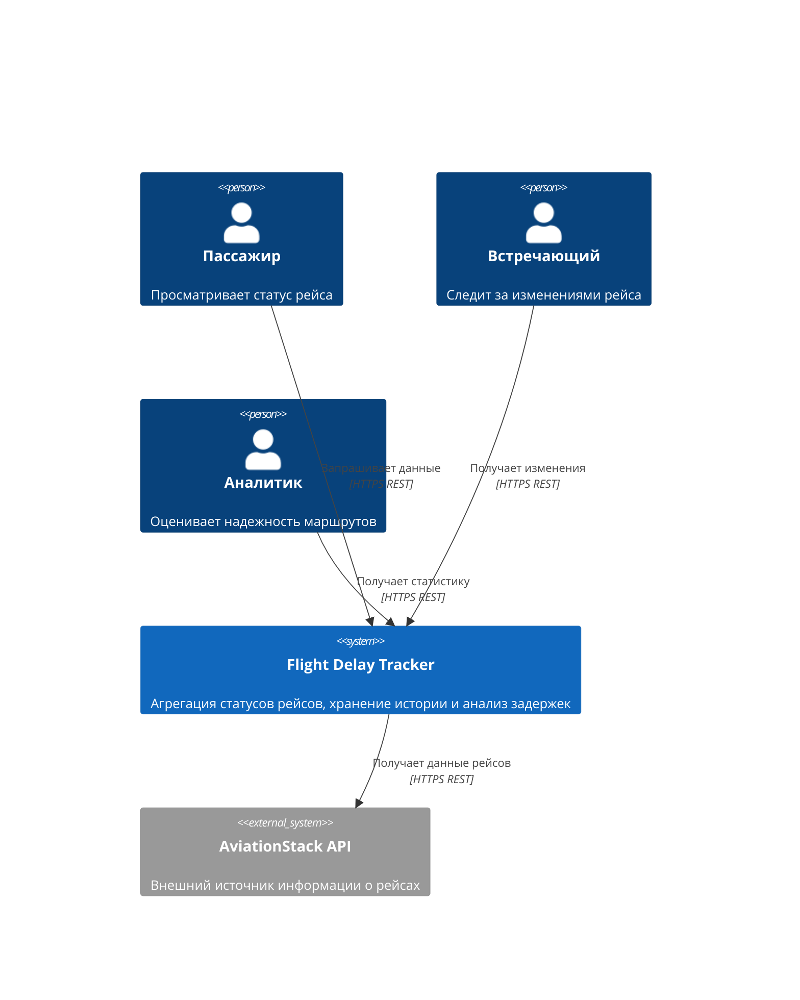
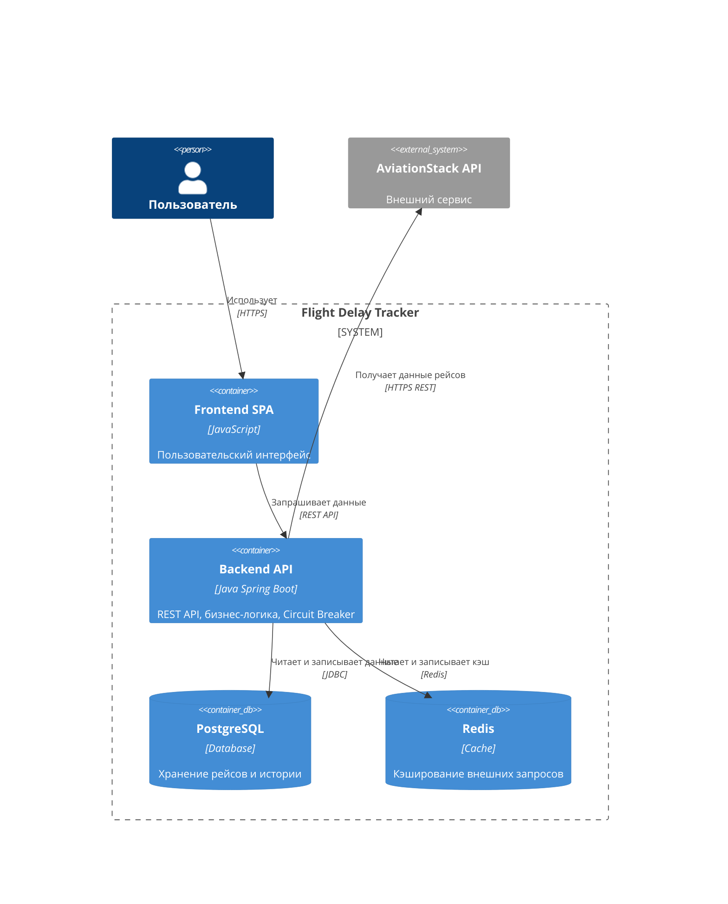
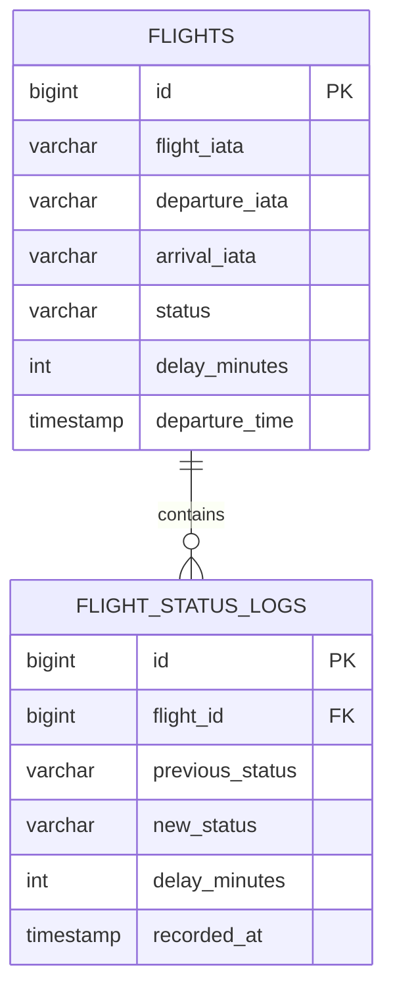

## Этап 1. Формулировка проблемы и концепция

### Суть решаемой проблемы
Пассажиры и встречающие регулярно сталкиваются с внезапными переносами рейсов и сменой выходов на посадку, о которых табло аэропортов и авиакомпании сообщают с критическим опозданием. Отсутствие единого источника консолидированных данных и предиктивных оповещений приводит к опозданиям на пересадки, финансовым потерям и стрессу. Разрабатываемый сервис агрегирует статусы перелетов в реальном времени, отслеживает динамику задержек и заблаговременно информирует пользователей об изменениях расписания.

### Технологический стек
* **Бэкэнд:** Java
* **БД:** PostgresSQL
* **Фронтэнд:** JavaScript
* **Внешние апи:** Aviation Stack API

---

## Этап 2. Пользовательские сценарии и расчет нагрузок
### Пользовательские сценарии (User Stories)
1. **US-1 (Пассажир):** Как авиапассажир, я хочу ввести номер рейса (например, `SU-100`) и дату, чтобы получить актуальный статус вылета, терминал, гейт и расчетное время задержки.

**Критерии приемки:**
- пользователь может указать номер рейса и дату;
- при наличии данных, система отображает основные сведения о рейсе: статус, аэропорты вылета и прилёта, расчётное время и величину задержки;
- система показывает время последнего обновления данных;
- если актуальные данные временно недоступны, но в PostgreSQL сохранено последнее известное состояние рейса, система возвращает его с признаком dataFresh = false;
- если рейс не найден, пользователь получает соответствующий ответ.

2. **US-2 (Встречающий):** Как встречающий, я хочу подписаться на изменения статуса рейса, чтобы своевременно получить push- или webhook-уведомление о переносе времени посадки без постоянного обновления страницы.

**Критерии приемки:**
- пользователь получает текущий статус рейса и ожидаемое время прибытия;
- при наличии задержки система показывает её величину;
- при отмене рейса система явно отображает состояние CANCELLED;
- ответ содержит время последней успешной синхронизации с внешним источником.

3. **US-3 (Аналитик):** Как аналитик, я хочу просматривать историю задержек рейсов по выбранному маршруту или номеру рейса и получать показатели надежности, чтобы оценивать стабильность выполнения рейсов и выявлять маршруты с частыми задержками.

**Критерии приемки:**
- пользователь может выбрать рейс или маршрут для анализа;
- система отображает историю изменений статуса и задержек по сохранённым рейсам;
- система рассчитывает основные показатели надежности: среднюю задержку, долю рейсов без задержек и долю отменённых рейсов;
- система позволяет получить результат анализа на основе исторических данных, даже если внешний AviationStack API временно недоступен;
- если данных недостаточно для корректного анализа, система явно сообщает об этом пользователю;
- при использовании устаревших данных система отображает время последнего обновления.

### Расчет нагрузок (Capacity Planning)
#### 1. Исходные параметры
* **Целевая аудитория (DAU):** $10\,000$ активных пользователей в сутки.
* **Средняя активность:** 1 пользователь совершает в среднем 8 запросов на чтение (просмотр табло, поиск рейса) и 0.5 запросов на запись (создание подписки на рейс).
* **Суточный объем запросов:**
  * Запросы на чтение (Read): $10\,000 \times 8 = 80\,000$ запросов/сутки.
  * Запросы на запись (Write): $10\,000 \times 0.5 = 5\,000$ запросов/сутки.
  * Фоновые синхронизации с внешним API: $1\,000$ отслеживаемых рейсов $\times 4$ обновления/час $\times 24 = 96\,000$ запросов/сутки.
  * Всего входящих HTTP-запросов к API: $85\,000$ запросов/сутки.

#### 2. Расчет RPS (Requests Per Second)
* **Средний RPS:** $$\text{RPS}_{\text{avg}} = \frac{85\,000}{86\,400} \approx 0.98 \approx 1.0\ \text{req/s}$$
* **Пиковый RPS:** Учитывая, что 70% пользовательской активности приходится на дневные 8 часов с коэффициентом неравномерности \(k = 3\): 
$$ 
\text{RPS}_{\text{peak}} = \text{RPS}_{\text{avg}} \times 3 \approx 3.0 - 5.0\ \text{req/s} 
$$
* **Соотношение Read / Write:** \(\approx 16:1\) — система с преобладанием операций чтения.


#### 3. Расчет дисковой памяти под PostgreSQL (на 5 лет)
В системе персистентно хранятся две основные сущности:
1. **Таблица `flights`:**
   * Уникальных рейсов в сутки: $\approx 1\,000$ записей.
   * Размер одной строки (с учетом индексов и накладных расходов PostgreSQL): $\approx 400$ байт.
   * Объем за 5 лет:
     $$1\,000 \times 365 \times 5 \times 400\text{ байт} \approx 730\text{ МБ}$$

2. **Таблица `flight_status_logs` (аудит задержек):**
   * Количество изменений статуса на рейс: $\approx 6$ событий.
   * Записей в сутки: $1\,000 \times 6 = 6\,000$ записей/сутки.
   * Размер одной строки лога с индексами: $\approx 150$ байт.
   * Объем за 5 лет:
     $$6\,000 \times 365 \times 5 \times 150\text{ байт} \approx 1\,642\text{ МБ} \approx 1.64\text{ ГБ}$$

* **Суммарный объем базы данных за 5 лет:**
  $$\text{Storage}_{\text{5y}} = 0.73\text{ ГБ} + 1.64\text{ ГБ} \approx 2.37\text{ ГБ}$$
  С учетом 30% резерва на WAL-логи, служебные таблицы Flyway и vacuum overhead: **$\approx 3.2\text{ ГБ}$**. Для хранения пятилетней истории достаточно минимального SSD-накопителя.

#### 4. Расчет оперативной памяти под кэш (Redis)
* **Стратегия кэширования:** кэшируются метаданные только активных суточных рейсов ($1\,000$ рейсов).
* **Размер JSON-структуры рейса:** $\approx 2$ КБ.
* **TTL ключа:** 180 секунд (3 минуты).
* **Объем активного кэша данных:**
  $$1\,000 \times 2\text{ КБ} = 2\,000\text{ КБ} \approx 2\text{ МБ}$$
* **Накладные расходы Redis:** под структуры данных, ключи поиска по аэропортам и сессии выделяется **$64 - 128\text{ МБ}$ RAM**, что с запасом перекрывает пиковые всплески.

---

# Этап 3. Архитектура и детальное проектирование

## 1. Capacity Planning
## 1.1 Расчет нагрузки
- Текущая нагрузка: RPSavg ≈ 1 req/sec
- Пиковая нагрузка: При масштабировании до 100 000 пользователей в сутки: 5 req/sec × 10 = 50 req/sec
- С учетом неравномерности активности: 50 × 3 = 150 req/sec
- Итог: Пиковая нагрузка при масштабировании: ≈150 запросов/сек

## 1.2 Read/Write нагрузка

| Тип операции                  | Доля |
|-------------------------------|------|
| Получение статуса рейса       | 70%  |
| Получение истории             | 20%  |
| Расчет рейтинга надежности    | 5%   |
| Обновление данных             | 5%   |
Итог: Read : Write = 95 : 5 ≈ 19 : 1

# 1.3 Расчет сетевого трафика
- Средний размер ответа: FlightResponseDto ≈ 500-600 байт
- Текущая нагрузка: 5 req/sec × 600 байт ≈ 3 КБ/сек
- При 100 000 пользователей: 150 req/sec × 600 байт ≈ 90 КБ/сек
- Суточный объем: 90 KB × 86400 ≈ 7.8 GB/day
- Redis Cache уменьшает количество запросов к внешнему AviationStack API.

# 1.4 Расчет дисковой системы (\>5 лет)
Основная историческая таблица: flight_status_logs

Предположения:
- 10 000 активных рейсов в сутки;
- обновление статуса каждые 15 минут;
- 96 обновлений одного рейса в сутки.

Количество записей: 10000 × 96 = 960000 записей/сутки

Размер записи: ≈300 байт

За 5 лет: 288 MB × 365 × 5 ≈ 525 GB

С учетом индексов, WAL и резервного копирования: ≈1 TB

# 2. C4 Model
## Context Diagram


## Container Diagram


# 3. API Contracts
## Получение активных рейсов
GET /api /v1 /flights /active

Latency: p95 < 300 ms

## Получение статуса рейса
GET /api /v1 /flights /{flightIata}

Порядок получения:
    Redis Cache
          |
          v
    PostgreSQL
          |
          v
    AviationStack API

Latency:
Cache hit: <300 ms
External API: <1.5 sec

## Получение истории рейса
GET /api /v1 /flights /{flightIata} /history

Latency: p95 < 500 ms

# 4. Нефункциональные требования
## Производительность
-   p95 latency основных GET запросов \<300 мс;
-   поддержка нагрузки до 150 RPS.

## Масштабируемость
Поддержка: 100 000 пользователей/сутки

за счет:
-   горизонтального масштабирования backend;
-   Redis Cache;
-   PostgreSQL Read Replica.

## Доступность
Availability ≥99.5%

## Отказоустойчивость
Используются:
-   Circuit Breaker;
-   fallback;
-   последние сохраненные данные.

# 5. Проектирование данных
## ER Diagram


# 5.1 Индексы базы данных
## Поиск рейса

``` sql
CREATE INDEX idx_flights_iata
ON flights(flight_iata);
```
Ускоряет поиск рейса по номеру.

## Получение истории

``` sql
CREATE INDEX idx_status_logs_flight_time
ON flight_status_logs(
flight_id,
recorded_at DESC
);
```
Ускоряет получение истории рейса.

## Расчет рейтинга

``` sql
CREATE INDEX idx_status_logs_status
ON flight_status_logs(
flight_id,
new_status
);
```
Ускоряет агрегирующие запросы.

# 6. Рейтинг надежности
Используемые метрики:
-   onTimeRate;
-   averageDelay;
-   cancellationRate.

Формула:
    score =
    clamp(
    100 -
    avg_delay_minutes * 0.5 -
    cancellation_rate * 100 * 2,
    0,
    100
    )

Расчет выполняется на основе: flight_status_logs

# 7. Масштабирование до 100 000 пользователей
## Backend
Используется горизонтальное масштабирование:

                 Load Balancer

                      |

           ----------------------

           |          |          |

         API 1      API 2      API 3

## PostgreSQL
    Primary DB

         |

    -----------------

    |       |        |

    Read1  Read2   Read3

Primary используется для записи, реплики --- для чтения.

## Redis Cache
Кэшируются:
-   статусы рейсов;
-   ответы AviationStack API.
TTL: 3 минуты
Для исторических данных: до 1 часа

## Защита внешнего API
Алгоритм:
1.  Проверить данные в Redis.
2.  Если данные есть --- вернуть из кэша.
3.  Если данных нет --- запросить AviationStack.
4.  Сохранить результат.
5.  Вернуть пользователю.

---

## Этап 4. Кодирование, отладка и автоматизация (CI/CD)
### 4.1. Цель этапа и соответствие методическим требованиям
| Требование этапа 4 | Реализация / подтверждение | Статус на момент подготовки раздела |
|---|---|---|
| Значимый кодовый вклад **каждого** участника | Ветки, коммиты, Pull Requests, связанные с Issues; персональные ссылки приведены в §4.4 | **Необходимо дополнить** доказательствами всех участников |
| Логирование в STDOUT для проверки работы и времени ответа | `backend/src/main/java/com/tracker/flight/logging/RequestLoggingFilter.java`; бизнес-логи `FlightService` | **Реализовано в коде**; фактический лог прогона приложить |
| Автоматическая сборка и запуск тестов на push/merge | `.github/workflows/ci.yml`, backend `mvn -B clean verify`, frontend `npm ci`, `npm test`, `npm run build` | **Настроено**; [пример успешного CI на `ab55535`](https://github.com/vol1sh/flight-tracker/actions/runs/40599416392) |
| Публичный репозиторий и управляемая разработка | [Репозиторий](https://github.com/vol1sh/flight-tracker), [Issues](https://github.com/vol1sh/flight-tracker/issues), [Pull Requests](https://github.com/vol1sh/flight-tracker/pulls), GitHub Projects | **Репозиторий и задачи существуют**; процесс каждого участника подтвердить ссылками |

### 4.2. Реализованная система и границы MVP
**Реализованные функции:**
1. Поиск по номеру рейса и обязательной дате в формате `YYYY-MM-DD`; нормализация номера.
2. Получение статуса, аэропортов, временных характеристик, величины задержки и служебных признаков свежести данных, если они доступны.
3. Раздельное хранение одинакового номера рейса для разных дат; получение истории конкретного выполнения рейса.
4. Использование сохранённых данных PostgreSQL при предусмотренных сценариях недоступности внешнего API, без подмены данными другой даты.
5. Кэширование через Redis с TTL **3 минуты**; обработка ошибок поставщика и механизмы отказоустойчивости.
6. Отображение в интерфейсе состояний загрузки, успешного ответа, отсутствия данных, недоступности сервиса и устаревшей информации.

**Связь с User Stories этапа 2:**
| User Story | Реализация в MVP |
|---|---|
| **US-1 — пассажир** | Основной сценарий поиска рейса по номеру и дате, статус, задержка, сведения об обновлении |
| **US-2 — встречающий** | Можно вручную отслеживать статус и прогнозируемое прибытие через интерфейс |
| **US-3 — аналитик** | Доступна история статусов конкретного рейса по дате |

### 4.3. Реализованные модули и их взаимосвязь
| Путь в репозитории | Назначение |
|---|---|
| `frontend/src/App.tsx` | Пользовательский интерфейс и HTTP-запросы к backend |
| `backend/src/main/java/com/tracker/flight/controller/FlightController.java` | Маршруты REST API для рейсов и истории |
| `backend/src/main/java/com/tracker/flight/service/FlightService.java` | Бизнес-логика, проверка даты, выбор PostgreSQL / AviationStack / fallback |
| `backend/src/main/java/com/tracker/flight/client/AviationApiClient.java` | Работа с внешним API и классификация ошибок |
| `backend/src/main/java/com/tracker/flight/config/RedisConfig.java` | Настройка кэша Redis, TTL 180 секунд |
| `backend/src/main/java/com/tracker/flight/logging/RequestLoggingFilter.java` | STDOUT-логирование HTTP-запросов и длительности |
| `backend/src/main/resources/db/migration/` | Версионируемые миграции Flyway |
| `.github/workflows/ci.yml` | Автоматическая сборка и тестирование |
| `docker-compose.yml` | Локальная оркестрация сервисов |

Реализованные HTTP-контракты:
```http
GET /api/v1/flights/active
GET /api/v1/flights/{flightIata}?date=YYYY-MM-DD
GET /api/v1/flights/{flightIata}/history?date=YYYY-MM-DD
GET /actuator/health
```
При выполнении поиска фронтенд обращается к backend; backend проверяет номер и дату, находит запись в PostgreSQL и при необходимости запрашивает AviationStack. Ответы поставщика могут кэшироваться в Redis, а обновлённые сведения — сохраняться в PostgreSQL. При невозможности получить данные приложение использует допустимый резервный сценарий или возвращает ошибку, не подставляя рейс за другую дату.

### 4.5. Качество кода и STDOUT-логирование
Для наблюдения за работой сервиса в `RequestLoggingFilter` используется фильтр `OncePerRequestFilter`, измеряющий время обработки через `System.nanoTime()` и логирующий:
- HTTP-метод и путь запроса;
- фактический HTTP-статус ответа;
- длительность обработки в миллисекундах (`durationMs`).

В `FlightService` также логируются нормализованный номер и дата поиска, источник (`source=DB`, `source=NONE` и другие сценарии), а также ситуации отказа внешнего поставщика. Логи выводятся в стандартный поток контейнера и доступны через Docker Compose.

**Запуск и просмотр STDOUT из корня репозитория:**
```bash
docker compose up -d --build
docker compose ps
docker compose logs -f --tail=100 backend
```

```bash
curl -i http://localhost:8080/actuator/health
curl -i 'http://localhost:8080/api/v1/flights/SU100?date=2026-10-27'
```

### 4.6. GitHub Actions
Конфигурация CI размещена в [`.github/workflows/ci.yml`](https://github.com/vol1sh/flight-tracker/blob/main/.github/workflows/ci.yml). Workflow запускается при `push`, а также при `pull_request` в ветку `main`.

| Job | Окружение | Действия |
|---|---|---|
| `backend-build-and-test` | Ubuntu, Eclipse Temurin Java 21, PostgreSQL 16, Redis 7 | Checkout, настройка JDK, `mvn -B clean verify` из `backend/` |
| `frontend-build` | Ubuntu, Node.js 22 | Checkout, `npm ci`, `npm test`, `npm run build` из `frontend/` |

Запуск Maven включает компиляцию и выполнение настроенных тестов. В проекте используются JUnit/Mockito, MockMvc, проверки клиента AviationStack через заглушки, а интеграционные проверки PostgreSQL работают через Testcontainers. Frontend-тесты выполняются с Vitest.

### 4.7. Отладка и проверка работоспособности MVP
Для приёмки MVP используется матрица QA: `docs/qa/MVP_TEST_MATRIX.md`. Проверки подразделяются на автоматизированные (JUnit, MockMvc, Testcontainers, Vitest), HTTP/контейнерные и ручные (браузер, PostgreSQL, GitHub).

| Проверка | Инструмент | Что должно быть подтверждено |
|---|---|---|
| Сборка и работа сервисов | Docker Compose + `/actuator/health` | PostgreSQL, Redis, backend, frontend доступны |
| Поиск сохранённого рейса | Браузер + DevTools Network + SQL | Номер, дата и поля совпадают в JSON, UI и БД |
| Обязательная дата и ошибочный номер | `curl`, `FlightControllerContractTest` | Корректные HTTP 400 |
| Изоляция разных дат | `FlightServiceTest`, `FlightRepositoryIntegrationTest` | Номер за разные даты не смешивается |
| Отказ внешнего API и fallback | `FlightServiceTest` | Не подставляются данные другой даты; корректная деградация |
| История и реакции интерфейса | `App.test.tsx`, браузер | Карточка, история, ошибки, предупреждение об устаревших данных |
| Реальное обращение к AviationStack | Backend + безопасный лог поставщика | Подтверждён успешный ответ без утечки ключа |
| STDOUT | Docker Compose logs | Путь, статус, `durationMs`, источник |
| CI | GitHub Actions | Backend и frontend jobs зелёные на проверенном SHA |

**Команды для повторяемой проверки:**
```bash
cp .env.example .env
docker compose up -d --build
docker compose ps
curl -i http://localhost:8080/actuator/health
curl -i http://localhost:3000/
docker compose logs --tail=100 backend
```

Для автоматических backend-тестов локально нужен Maven/Java 21 либо Maven-контейнер с доступом к Docker Engine для Testcontainers; для frontend — Node.js/npm либо соответствующая проверка CI. Самый воспроизводимый способ показать выполнение в отчёте — ссылка на конкретный workflow GitHub Actions.